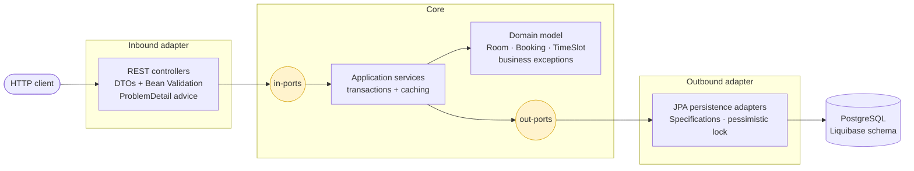

# 🗓️ Meeting Scheduler API


> A production-minded REST API for booking meeting rooms: no double bookings, clear errors, and nothing magical you'll have to fight later.

Hi! 👋 I'm **Lazaro**, a Java backend engineer with 4+ years of experience building Spring services. Over those years I've seen the same booking bugs again and again: two people in the same room at 10:00, a `500` where a `409` belonged, a cache serving yesterday's data. This project is my take on doing it right from day one, with a small codebase, explicit rules and tests that prove the rules hold.

---

## 📚 Table of contents

- [✨ What it does](#-what-it-does)
- [🚀 Run it in 2 minutes](#-run-it-in-2-minutes-no-java-needed)
- [📡 API tour](#-api-tour)
- [🏗️ Architecture](#️-architecture)
- [✅ Testing strategy](#-testing-strategy)
- [⚙️ Configuration](#️-configuration)
- [💡 Tips & tricks from the trenches](#-tips--tricks-from-the-trenches)
- [🗺️ Roadmap](#️-roadmap)
- [🌿 Workflow](#-workflow)
- [🤝 Acknowledgements](#-acknowledgements)

---

## ✨ What it does

| | Feature | Details |
|---|---|---|
| 🏢 | **Rooms** | Create, list and fetch rooms. Names are unique (case-insensitive). |
| 📅 | **Bookings** | Create, fetch and cancel bookings with a room, a person in charge and a time slot. |
| 🚫 | **No double bookings** | Overlapping requests get `409 Conflict`, even under concurrent load (row-level lock). |
| 🔎 | **Search** | Filter bookings by room and/or UTC day, with pagination (`page`, `size` ≤ 100). |
| 🛡️ | **Security** | HTTP Basic. Reads are public; every write needs credentials. |
| 🧾 | **Clear errors** | Every error is an [RFC 9457](https://www.rfc-editor.org/rfc/rfc9457) `ProblemDetail` with field-level validation messages. |
| ⚡ | **Caching** | Caffeine caches for hot reads, evicted *after* the write commits. |
| 🩺 | **Observability** | Actuator health/liveness/readiness, metrics (incl. cache hit/miss), build info. |
| 📖 | **Docs** | OpenAPI 3 + Swagger UI out of the box. |
| 🐳 | **Docker** | Multi-stage image (non-root, layered jar, healthcheck) + Compose with PostgreSQL. |

---

## 🚀 Run it in 2 minutes (no Java needed)

The only thing you need is **[Docker Desktop](https://www.docker.com/products/docker-desktop/)** (or Docker Engine + Compose). Java, Maven and PostgreSQL all run inside containers.

```bash
# 1. Get the code
git clone <this-repo-url> meeting-scheduler
cd meeting-scheduler

# 2. Build and start the API + PostgreSQL
docker compose up -d --build

# 3. Wait until it's ready (first build downloads dependencies, give it a minute or two)
curl http://localhost:8080/actuator/health
# {"groups":["liveness","readiness"],"status":"UP"}
```

That's it 🎉. Now open:

- 📖 **Swagger UI:** <http://localhost:8080/swagger-ui.html>. Click **Authorize** and use `admin` / `admin123` to try the write endpoints.
- 🩺 **Health:** <http://localhost:8080/actuator/health>

To stop everything:

```bash
docker compose down        # keeps your data
docker compose down -v     # also wipes the database volume
```

> 💡 **Tip:** change the default credentials before showing this to anyone:
> `APP_ADMIN_USERNAME=alice APP_ADMIN_PASSWORD='s3cr3t!' docker compose up -d`

### 🧪 Prove it works: the smoke test

Tests are great, but before trusting a deployment I like to hit the *real* running API. `scripts/smoke-test.sh` seeds a small dataset (4 rooms, several bookings) and runs **54 checks** over HTTP: every endpoint, the validation errors, the overlap rules, cancellation, cache eviction and a 10-request concurrency race.

```bash
./scripts/smoke-test.sh
# ...
# ▶ Concurrency: 10 simultaneous requests for one slot
#   ✔ exactly one 201 and nine 409 (created/conflicts)               1/9
#
# Result: 54 passed, 0 failed
```

It only needs `bash` and `curl` (on Windows, use **Git Bash** or WSL), and it's safe to re-run. Point it elsewhere with `BASE_URL=http://my-host:8080 API_USER=... API_PASS=... ./scripts/smoke-test.sh`.

### 👩‍💻 Running from source (for developers)

You need **JDK 21**, **Maven 3.9+** and **Docker running** (for Testcontainers).

```bash
mvn spring-boot:test-run     # starts the app against a throwaway PostgreSQL container
mvn clean verify             # 101 tests + JaCoCo coverage gate (≥ 85% lines)
```

---

## 📡 API tour

Base path: `/api/v1`. 🔓 = public, 🔐 = HTTP Basic required.

| Method | Path | Auth | Success | Errors |
|---|---|---|---|---|
| `POST` | `/rooms` | 🔐 | `201` + `Location` | `400`, `401`, `409` duplicate name |
| `GET` | `/rooms` | 🔓 | `200` | |
| `GET` | `/rooms/{id}` | 🔓 | `200` | `400`, `404` |
| `POST` | `/bookings` | 🔐 | `201` + `Location` | `400`, `401`, `404` room, `409` overlap |
| `GET` | `/bookings?roomId=&date=&page=&size=` | 🔓 | `200` (paginated) | `400` |
| `GET` | `/bookings/{id}` | 🔓 | `200` | `404` |
| `DELETE` | `/bookings/{id}` | 🔐 | `204` (soft cancel) | `401`, `404`, `409` already cancelled |

All the responses below were captured from a real run (line breaks added for readability).

**Create a room**

```bash
curl -u admin:admin123 -H "Content-Type: application/json" \
     -d '{"name":"Nebula","capacity":10,"location":"4th floor"}' \
     http://localhost:8080/api/v1/rooms
```
```json
{"id":9,"name":"Nebula","capacity":10,"location":"4th floor"}
```

**Book it** (times are ISO-8601 in UTC, and the start must be in the future)

```bash
curl -u admin:admin123 -H "Content-Type: application/json" \
     -d '{"roomId":9,"personInCharge":"Ada Lovelace","startTime":"2031-07-01T09:00:00Z","endTime":"2031-07-01T10:00:00Z"}' \
     http://localhost:8080/api/v1/bookings
```
```json
{"id":13,"roomId":9,"personInCharge":"Ada Lovelace","startTime":"2031-07-01T09:00:00Z","endTime":"2031-07-01T10:00:00Z","status":"ACTIVE"}
```

**Try to double-book it** → `409 Conflict`

```json
{"detail":"Room 9 is already booked between 2031-07-01T09:30:00Z and 2031-07-01T10:30:00Z",
 "instance":"/api/v1/bookings","status":409,"title":"Conflict",
 "timestamp":"2026-11-14T21:37:38.244445691Z"}
```

**Send garbage** → `400 Bad Request`, with every problem listed at once

```json
{"detail":"Request contains invalid fields","instance":"/api/v1/bookings","status":400,
 "title":"Validation failed","timestamp":"2026-11-14T21:37:38.461326634Z",
 "errors":[{"field":"endTime","message":"must be after startTime"},
           {"field":"personInCharge","message":"must not be blank"}]}
```

**Search** a room's bookings for a day

```bash
curl "http://localhost:8080/api/v1/bookings?roomId=9&date=2031-07-01&page=0&size=5"
```
```json
{"content":[{"id":13,"roomId":9,"personInCharge":"Ada Lovelace","startTime":"2031-07-01T09:00:00Z","endTime":"2031-07-01T10:00:00Z","status":"ACTIVE"}],
 "page":0,"size":5,"totalElements":1,"totalPages":1}
```

**Cancel**

```bash
curl -u admin:admin123 -X DELETE http://localhost:8080/api/v1/bookings/13   # 204, a second call returns 409
```

### 📏 The rules, explicitly

- ⏱️ Slots are **half-open** `[start, end)`. `09:00–10:00` and `10:00–11:00` do **not** clash, but anything that overlaps by even a minute does.
- ❌ Cancelled bookings stay in the history (`status: CANCELLED`) and **free the slot** right away.
- 🌍 `date=2031-07-01` means "bookings that overlap that **UTC** day". Results are ordered by start time.
- 📄 `size` defaults to 20 and is capped at 100, so nobody can ask for a million rows by accident.

---

## 🏗️ Architecture

The project uses **hexagonal architecture (ports & adapters)**. The domain is plain Java with no Spring and no JPA, so the business rules can be read and unit-tested in isolation, and the frameworks stay at the edges.



```text
net.space.developer.meetingscheduler
├── domain/                 🧠 pure Java: model, exceptions, ports (in/out)
├── application/            ⚙️ use-case services: @Transactional, @Cacheable
├── adapter/in/web/         🌐 controllers, DTOs, validation, error handling
│   └── common/             🧰 Problems, FieldViolation, Locations, ApiDocs
├── adapter/out/persistence/ 🗄️ JPA entities, repositories, adapters
└── config/                 🔧 security, caching, OpenAPI
```

### 🧭 Decisions worth explaining

| Decision | Why |
|---|---|
| 🔒 **Pessimistic lock on the room row** before the overlap check | A plain "check then insert" lets two concurrent requests both pass. Locking the room serializes bookings *per room* while different rooms stay parallel. A test and the smoke script both fire concurrent requests to prove it. |
| 🧱 **Half-open intervals** (`start < otherEnd && end > otherStart`) | This is the only definition where back-to-back meetings work without off-by-one hacks. |
| 🗑️ **Soft cancel** instead of `DELETE FROM` | You keep an audit trail, and "who cancelled the 10:00?" stays answerable. |
| 🧾 **RFC 9457 ProblemDetail** everywhere, including `401` | One error shape means frontends write one error handler. |
| ⚡ **Cache advice wraps the transaction** (`@EnableCaching(order = HIGHEST_PRECEDENCE)`) | Evicting *before* commit lets a concurrent read put stale data back in the cache. Evicting *after* commit closes that window. |
| 📜 **Liquibase owns the schema**, Hibernate only `validate`s | The schema is versioned, reviewed and identical in tests, Docker and production. If code and schema drift apart, the app refuses to start. |
| 🧩 **Bookings reference rooms by id**, not by `@ManyToOne` | Aggregates stay small, there's no lazy-loading surprise, and there's **no N+1 problem** by construction. |
| 🎯 **Specifications** for search | Optional filters compose cleanly, without `(:param is null or …)` JPQL tricks that confuse PostgreSQL's type inference. |

---

## ✅ Testing strategy

**101 tests, 100% line coverage**, enforced at build time by a JaCoCo gate (≥ 85%). The tests were written **test-first**: every feature branch has a red `test:` commit before the green `feat:` one.

| Layer | Tooling | Examples |
|---|---|---|
| 🧠 Unit | JUnit 5, AssertJ, Mockito | `TimeSlotTest` (8 overlap cases), `BookingServiceTest`, validator tests |
| 🌐 Web slice | `@WebMvcTest` + MockMvc + real security | status codes, ProblemDetail bodies, `401`s, pagination params |
| 🗄️ Integration | `@DataJpaTest` + **Testcontainers PostgreSQL** | Liquibase constraints, overlap query, search & paging, cache eviction |
| 🌍 End-to-end | `@SpringBootTest(RANDOM_PORT)` + `RestTestClient` | full lifecycle, plus a concurrent race that must yield exactly one `201` |
| 🧪 Smoke | `scripts/smoke-test.sh` against a running instance | 54 checks with real data |

```bash
mvn test -Dtest=BookingServiceTest                           # one class
mvn test -Dtest=BookingServiceTest#rejectsOverlappingBooking # one method
# coverage report: open target/site/jacoco/index.html in your browser after `mvn verify`
```

> 🐳 Most tests start a real PostgreSQL with Testcontainers, so **Docker must be running**. H2 would be faster, but it would happily pass queries that PostgreSQL rejects. Test against what you ship.

---

## ⚙️ Configuration

Everything has a sensible default and can be overridden with environment variables:

| Variable | Default | Purpose |
|---|---|---|
| `DB_URL` | `jdbc:postgresql://localhost:5432/meeting_scheduler` | JDBC URL |
| `DB_USERNAME` / `DB_PASSWORD` | `meeting` / `meeting` | Database credentials |
| `APP_ADMIN_USERNAME` / `APP_ADMIN_PASSWORD` | `admin` / `admin123` | API user (BCrypt-hashed at startup) |

Exposed Actuator endpoints are `health` (public, with `liveness`/`readiness` groups), `info`, `metrics` and `caches` (all authenticated).

---

## 💡 Tips & tricks from the trenches

A few lessons from years of on-call, all baked into this codebase:

1. 🕐 **Store `Instant`, talk UTC, convert at the edges.** `timestamptz` in PostgreSQL plus `Instant` in Java means you'll never have to debug a daylight-saving bug at 3 a.m.
2. 🔐 **"Check, then insert" is a race condition.** Validation in the service isn't enough on its own; take a lock, or let the database enforce the rule. `DataIntegrityViolationException` is mapped to `409` as a safety net.
3. 🧯 **Never leak internals in a 500.** The advice logs the stack trace server-side and returns a generic message. The tests explicitly check that a fake "password" never reaches the response body.
4. 📜 **Never edit a migration that has already run.** Liquibase stores checksums and will refuse to start. Add `003-…yaml` instead.
5. 🧪 **Name integration tests by what they need, not what they test.** `*IntegrationTest` means "needs Docker", so people know why a test is slow.
6. 🧱 **Keep DTOs at the boundary.** Request records validate input, response records shape output, and the domain never sees JSON.
7. 📦 **Cap your page sizes.** An unbounded `size` parameter is a denial-of-service waiting to happen.
8. 🐳 **Run as non-root and add a `HEALTHCHECK`.** Your orchestrator (and your security team) will thank you.
9. 🔁 **Make smoke tests repeatable.** The script suffixes names per run, so it can hit staging every deploy without manual cleanup.

---

## 🗺️ Roadmap

Things I'll add when I have more time, roughly in priority order:

- [ ] 🔄 **CI/CD pipelines**: GitHub Actions running `mvn verify` with Testcontainers, building and scanning the image, and deploying with the smoke test as a post-deploy gate.
- [ ] 🔑 **JWT / OAuth2 login** (e.g. Sign in with Google) through Spring Authorization Server or an external IdP, with per-user ownership of bookings ("only the organizer can cancel").
- [ ] 🚦 **Rate limiting** (Bucket4j or at the gateway) to protect write endpoints from bursts and get rid of bottlenecks before they hurt.
- [ ] 🗃️ **Pluggable cache manager**: switch between local Caffeine and **Redis** with a profile, so heavier loads and multiple instances share one cache.
- [ ] 🔗 **HATEOAS** links (`self`, `room`, `cancel`, pagination `next`/`prev`) so clients can navigate the API without hard-coded URLs.
- [ ] 🧮 **N+1 watch**: there's no N+1 today because bookings reference rooms by id. Once responses embed room details, use fetch joins or entity graphs, and enforce it with Hibernate statistics checks in tests.
- [ ] ⚡ **GraalVM native image** for near-instant startup and a smaller memory footprint in containers.
- [ ] 🤖 **RAG AI assistant**: ask things like *"Is a 10-person room free tomorrow afternoon?"* in plain language, answered from the API's data without touching the endpoints yourself.
- [ ] 🧷 **Database-level guarantee** with a PostgreSQL exclusion constraint (`EXCLUDE USING gist`), as a second line of defense against overlaps.
- [ ] 🔭 **Distributed tracing** (Micrometer Tracing + OpenTelemetry) to follow a request end-to-end.

---

## 🌿 Workflow

This repo follows **Git Flow**:

- `feature/*` branches start from `develop` and are merged back with `--no-ff`, so every feature stays visible in the history. Feature branches are **kept**, so you can review each one on its own.
- `release/x.y.z` branches go to `main` (tagged `vx.y.z`) and back into `develop`.
- Commits follow a TDD rhythm: `test:` (red) → `feat:` (green) → `refactor:` (clean).

```bash
git log --oneline --graph --all   # the history reads like a changelog
```

---

## 🤝 Acknowledgements

I built this project together with **Claude** (Anthropic's AI assistant), and I want to be precise about what that collaboration looked like, because "an AI wrote it" isn't the story.

I brought the requirements, the engineering standards (SOLID, DRY, KISS, TDD, Git Flow, hexagonal design) and the final say on every decision. From those details, Claude helped **define the architecture and the organization of the project**, kept a close eye on **performance and correctness** (the room lock, cache-after-commit ordering, capped pagination, no N+1 by design), and, most valuable to me, **discussed the right way to implement things** before writing them. We weighed options like Basic vs JWT, pessimistic locks vs exclusion constraints, and H2 vs Testcontainers, and settled each one on its merits.

I reviewed the result, reorganized packages and documented the code myself, and Claude reviewed my changes in return. That's how I like to work with any good teammate. 🙌

---

## 👤 Author

**Lazaro Noel Guerra Medina**, Java Backend Engineer

> *"Make it work, make it right, make it fast, in that order, and write the test first."* ☕
